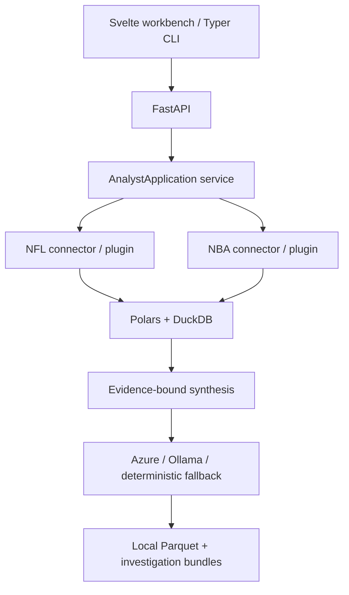

# Open Sports Analyst

Open Sports Analyst is a local-first NFL, NBA, and soccer analysis workbench that turns natural-language questions into reproducible, evidence-linked investigations over
locally
stored [nflverse](https://nflverse.nflverse.com/), [SportsDataverse](https://py.sportsdataverse.org/docs/nba/), and ESPN soccer match data.

The model plans and explains the investigation. Versioned analytical tools, Polars, and constrained read-only DuckDB SQL calculate the results. Every measured claim must cite
evidence produced by those tools; the model cannot invent measurements or execute arbitrary Python.

## What the application does

- Runs NFL team analysis for passing, rushing, and overall offense, plus player analysis for quarterbacks, receivers, and ball carriers.
- Runs NBA team or player analysis across full seasons and validated season segments, with an optional team-stint filter for traded players.
- Runs soccer team and player comparisons for the Premier League, MLS, La Liga, Bundesliga, Serie A, Ligue 1, NWSL, and UEFA Champions League. Match scores, team statistics,
  lineups, and key events
  are downloaded by competition and season; date-range comparisons and recorded match timelines are available. Missing match sections are disclosed rather than estimated.
- Provides the mature NFL diagnostic suite: trends, benchmarks, outliers, situational splits, play mix, opponent context, change points, player usage, and availability
  context.
- Provides NBA v1 box-score comparisons, multi-season trend charts, lineup-rate comparisons when lineup releases are synced, and diversified play/possession evidence from both
  comparison windows.
- Surfaces NFL evidence in an interactive field schematic, NBA evidence in a basketball tablet, and soccer evidence in a recorded match timeline (not a location-based pitch
  replay).
- Selects representative evidence deterministically across different games and contexts, labeling typical examples, metric-relevant examples, support for the measured change,
  and counterexamples.
- Produces evidence-bound findings, charts, methodological caveats, team-themed HTML reports, and Markdown exports.
- Saves investigations locally, supports follow-up conversations as child investigations, and allows complete investigation threads to be deleted.
- Remains usable without a configured model by generating a deterministic evidence report.

Open Sports Analyst ships independent NFL, NBA, and soccer plugins. Persistent sport tabs preserve each sport's unfinished form state while changing its subjects, seasons,
periods, metrics, datasets, and evidence renderer.

## Application tour

The Svelte workbench provides:

1. **Getting started** — a dismissible inline guide explains data, comparisons, and evidence. Completion is remembered in browser storage; **Getting started** restores it.
2. **Prepare your data** — quick setup uses the sport plugin's required and recommended sources. Choose seasons, then explicitly download. **Customize data sources** exposes
   individual packages, availability, and downloaded badges. Ready data collapses into a status strip.
3. **Subject → Comparison → Focus → Question** — searchable team/player controls, reference and comparison periods, recommended metrics, and selectable example questions form
   one continuous workbench. **Customize metrics** and **Optional breakdowns** reveal advanced choices; **About** opens each metric's formula, interpretation, sample, and
   limitations. On the soccer tab, select a competition before syncing or choosing a subject.
4. **Analysis brief** — a live summary and actionable readiness checklist explain what will run and what still needs attention. NFL/NBA drafts remain independent, including
   custom metric selections.
5. **Progress** — downloads show source-level stages; completed syncs offer **Continue building analysis**. Investigation stages describe the work as evidence is produced and
   reviewed.
6. **Results** — the direct answer leads into key metric changes, findings, supporting evidence, charts, and representative plays. The first finding opens automatically. On
   narrow screens, evidence appears directly below its finding. Sources, caveats, and tool records are grouped under **How this analysis was calculated**.
7. **Film Room** — reopen, continue, export, or delete saved investigation threads.

## Mobile browser use

The web workbench reflows for narrow screens. NFL/college-football fields and NBA courts offer an expanded view with zoom buttons, touch pan/pinch, a play-focus shortcut, and a full-view reset. Tap a marker or use the player/event picker for persistent details; recorded, projected, and inferred labels are preserved. Escape closes the expanded view and restores focus.

On phones, mixed-metric comparisons show exact values and first-to-last numeric differences before the optional chart. Rate differences use percentage points, not relative percentage changes. Metric filters and expanded charts remain available. College-football comparison tables scroll inside their own labeled region.

For mobile QA, check 320px and 390px portrait layouts, landscape, the on-screen keyboard, marker selection, expand/zoom/reset, and report navigation. Desktop browser emulation is useful but does not replace Android Chrome and iPhone Safari checks, especially for pinch gestures, safe areas, and keyboard behavior.

### Testing over cellular with ngrok

Use `ngrok.yml.example` as the template for a private `ngrok.local.yml` (the local file is excluded from Git and Docker build contexts). Replace the authtoken with your ngrok dashboard authtoken and replace the entire password placeholder with a long, unique password. The browser username is `mobile`. Do not put model-provider credentials in this file. If you need a particular endpoint URL, uncomment `url` and use the exact HTTPS dev domain assigned in your ngrok dashboard.

From the repository root, build the frontend and start the API:

```cmd
npm --prefix frontend run build
uv run sports-analyst serve
```

Confirm `http://127.0.0.1:8767` opens the built app, then in a separate terminal:

```cmd
ngrok config check --config .\ngrok.local.yml
ngrok start sports-analyst --config .\ngrok.local.yml
```

Open the HTTPS forwarding address on your phone over cellular and authenticate as `mobile` with your chosen password. Both the frontend and `/api` use this single protected endpoint; Vite is not needed. Keep the API and tunnel running while testing; Ctrl+C stops the tunnel. Anyone with the browser credentials has access to the local app's data and operations, including model-backed requests, so do not share them. ngrok transports your requests through its service; use test data where possible. Do not commit the local configuration or copy it into deployment/installer artifacts.

## Quick start

### Requirements

- Python `>=3.13,<3.15`
- [uv](https://docs.astral.sh/uv/)
- Node.js 20 or newer
- npm

### Install

```powershell
git clone https://github.com/chandapanda99/SportsAnalyst.git
Set-Location SportsAnalyst

Copy-Item .env.example .env
uv sync --extra test

Set-Location frontend
npm ci
Set-Location ..
```

### Run

Start the API in one terminal:

```powershell
uv run sports-analyst serve
```

Start the web application in a second terminal:

```powershell
Set-Location frontend
npm run dev
```

Open [http://127.0.0.1:5173](http://127.0.0.1:5173). Vite proxies `/api` requests to the FastAPI server at `http://127.0.0.1:8767`.

You do **not** need to run a data-sync command before launching the application. Open **Prepare your data** (or **Manage data**), choose seasons, and use the **Download**
button. NFL quick setup includes play-by-play and recommends schedules, player statistics, and rosters. NBA requires play-by-play, schedules, team box scores, and player box
scores for the guided flow. The application reports whether the optional live transport is installed, but
current NBA investigations use synced bulk releases and do not make live NBA Stats calls.
For soccer, select a competition, choose seasons, and sync the desired match packages. Soccer data is keyed by competition, so syncing MLS cannot overwrite a
Premier League season. Completed matches with unavailable summaries remain in the fixture catalog; partial match-detail syncs can be retried from the data library.

The same download can be started from the CLI, for example `uv run sports-analyst data sync soccer --competition eng.1 --season 2025`. For European leagues, the season number
is its ending year (2025 means 2024–25); MLS and NWSL use the calendar year. Selected-player assist game logs are requested and cached only if that metric is used and ESPN
provides the log for both windows.

Champions League uses `uefa.champions` and ending-year season labels (2027 means 2026–27). The existing match, player and xG analysis paths apply, subject to recorded
coverage. Evidence retains recorded stage and match notes, including shootout tallies where supplied. Comparisons are match-level, not aggregate-tie outcomes: extra-time goals
count, shootout tallies do not, and tied match scores remain draws. Points per match includes only recorded league/group-phase matches. Use date windows to narrow tournament
context; dedicated stage filters and two-legged tie analysis are not yet included.

**Team Match Statistics** also fetches ESPN Core expected-goals statistics through SportsDataverse in the same sync. Team analysis supports xG, xG against, xG difference,
non-penalty xG, and goals minus xG per match. Player scoring analysis supports recorded xG, non-penalty xG, and goals minus xG; only the selected player's match statistics are
fetched and cached when requested. Match evidence also displays each team's recorded xG. Sync Team Match Statistics (and lineups for players) before selecting these metrics.
Existing xG snapshots remain compatible; xG coverage is tracked independently internally and shown alongside the bundled match statistics.
Missing values are excluded, never replaced with zero, and comparisons report their qualifying-match coverage. Both windows need recorded values.
Historical coverage is not guaranteed: a September sample across all seven competitions found xG in the checked 2026 matches but not the checked 2024/2025 matches.
Use covered seasons or date ranges within a covered season. These are match statistics, not shot-location data or tracking replay.
See the [SportsDataverse Core statistics documentation](https://js.sportsdataverse.org/docs/soccer/reference/core#espnsoccereventcompetitorstatistics).

Soccer also offers **Published season** metrics in Customize metrics for full-season comparisons: team/player goals, assists, shots, shots on target, passes,
accurate passes, tackles, interceptions and appearances, plus player minutes. These Core season statistics are fetched and cached only for the selected subject.
The connector verifies season/subject references, uses combined totals without also adding their component stages, and requires verified match stages when summing
disjoint tournament phases. Missing partitions or fields are not treated as zero. Published totals remain distinct from locally reconstructed match totals and
cannot be used for date-range comparisons or inferred match events. Season xG/non-penalty xG metrics are offered only where cached season statistics record those fields;
historical team/player season endpoint samples also lacked xG. In-season snapshots are refreshed when requested.

## Automatic investigation preparation

NFL, NBA, soccer and college-football investigations now check their selected data scope before analysis and prepare missing dependencies in the investigation worker.
Progress remains attached to the investigation; a separate manual sync is no longer required when a valid subject and preparable periods can be selected.
The UI distinguishes **locally available** seasons from **preparable** source seasons. A preparable metric is not a promise that both windows contain usable values:
the deterministic analysis still verifies attribution, required fields and qualifying samples. Player selection requires a discoverable identity; this flow does not
invent player history, historical roster membership or missing source statistics. Explicit library downloads remain available for offline use and bulk research.

NFL/NBA retain their published bulk package formats. Ordinary preparation fetches core/metric dependencies rather than every optional package.
Successful historical snapshots are reused; incomplete acquisition is retried. Automatic current-season preparation reuses snapshots acquired within one hour,
then refreshes needed packages. Explicit sync retains its existing current-season refresh behavior. Preparation leases coalesce desktop workers on shared local storage
and cloud replicas when durable conditional-write persistence is configured. Without durable persistence, cloud caches/coordination remain instance-local.

Soccer team investigations prepare **team/competition/season partitions**, fetching summaries only for that team's fixtures, including its opponents.
An existing complete competition snapshot can be projected locally without source downloads or overwriting that snapshot; original acquisition time and provenance
are preserved. Fixtures still use the provider's competition schedule discovery; this is scoped match-detail acquisition, not a claim of team-filtered network
scoreboard downloads. Successful raw summaries are shared locally and, when configured, durably across preparations. Simultaneous current-season summary refreshes
may reuse a five-second hot cache. Results-only preparation does not request xG; explicit Team Match Statistics downloads still bundle xG as before.
Soccer player investigations retain competition-wide preparation to avoid excluding transfer appearances. Empty libraries can use a cached lightweight team directory;
historical clubs not in that current directory can still be discovered through explicit season fixture downloads. Library package badges describe full competition
downloads, not a small team snapshot. Clearing a competition removes its scoped snapshots and raw caches without deleting saved investigations.

## NFL game browsing

NFL representative-play tablets also provide a recorded-game browser: search, previous/next, and return to the cited play. Browsing reads only that game's rows
from the synced season, without applying the investigation's team, player or situation filters. Opponent, special-teams and missing-EPA plays remain visible.
Available participation, charting and identity data enrich the same schematic. Browsing does not modify report evidence; a changed snapshot is labeled, and
the original cited play remains available when full-game data has been cleared or cannot load. Local installations and durable-storage deployments use the same path.

## College football: FBS and FCS

The College Football tab discovers teams by **browse season → subdivision → conference/independents → school**.
Conference membership is season-specific and only organizes selection: team analysis includes recorded nonconference and cross-subdivision games.
Directories load on demand; selecting a conference does not download its rosters or game statistics. Player searches are limited to the chosen school/roster season,
with a maximum of 25 matches. Selecting a player verifies their historical seasons through ESPN's statistics log.

Run an investigation to prepare only the selected subject's missing game summaries and statistics. Team results and offensive box-score comparisons are supported,
as are quarterback, rushing and receiving player metrics. Player investigations follow ESPN athlete IDs and season game logs across transfers rather than matching names.
Rates use summed numerators and denominators. Missing sections and incomplete samples are shown as coverage gaps, never assumed to be zero.
Historical data is reused; current-season directories and snapshots refresh on bounded cache intervals. No national CFB season play-by-play or roster download is required.

CFB packages distinguish available data, partial downloads, missing source sections, failed requests, and unverified seasons. Missing rosters do not block usable
team game statistics. Roster responses are cached for at most an hour (five minutes for the current season), rather than retaining an empty historical roster for a year;
failed requests remain retryable. Rosters are fetched only when selected. When a verified roster is unavailable, player search can use the selected school's downloaded
offensive game participants, explicitly labeled as an incomplete roster substitute. Availability metadata persists alongside snapshots in local and durable storage.
Empty or unverifiable team-roster responses now fall back to paginated, season-specific school athlete references, with bounded concurrent athlete resolution.
Verified completed games provide an additional historical game-roster fallback, labeled as incomplete season coverage. Fully resolved school/season rosters are cached
as a lightweight player-search directory; no national roster scan is needed. Conference downloads report cumulative school/season progress, and local progress streams
use permanent event sequence numbers so completion remains visible when old updates are trimmed.

CFB investigations prepare cached recorded plays for the endpoint windows before evidence selection. The shared diversity selector chooses metric-relevant typical,
supporting and counterexample plays from covered games; player examples require structured athlete-role IDs. Penalty/no-play rows are excluded from the evidence pool.
Box-score aggregates keep their own game/attempt denominators; play examples do not replace those totals or establish causality. Selected play IDs, selection reasons,
narrative formation labels and per-play personnel-source status are available to synthesis, follow-ups and exports. The tablet opens on the cited play and keeps
full-game browsing available as secondary context. Missing play coverage falls back to explicitly labeled game context. All marker positions remain illustrative;
formation labels and personnel endpoint entries do not establish tracking, routes, defensive assignments or a verified full on-field lineup.

The data manager supports explicit selected-school downloads; the conference selector also provides an explicit conference download for the selected sync seasons.
Scoped snapshots coexist in the catalog using team/player partition identities, while game summaries are shared across schools. Cloud replicas coordinate source requests
through durable leases; desktop processes use local leases. Clearing College Football data clears its source cache and snapshots, not saved investigations.

Game evidence shows recorded opponents, score, offensive statistics and scoring events. Opening CFB evidence automatically loads the selected game's recorded plays
through bounded, cached ESPN play requests. A searchable selector and previous/next controls open the college-football field tablet. Start/end yard positions,
down/distance, recorded scores and involved athlete IDs come from the source. School colors and provided home logos brand the field and markers.
The feed's participants are play actors, not a complete 22-player lineup; marker locations are explicitly illustrative. It does not supply actual formations,
routes, coverage assignments or tracking coordinates. Names resolve by athlete ID from that game's box score, without unrelated roster or per-athlete fan-out.
Older saved evidence without the new context can load recorded details while keeping its saved modeled values.
Enriched investigations also show offensive EPA/play, qualifying plays and game counts for the prepared comparison-window sample—not a national/conference ranking.
Optional advanced metrics trigger SportsDataverse's per-game processing pipeline against the cached summary, joined to bounded ESPN play/participant requests.
The **Enriched Plays** package can also be downloaded explicitly. Basic investigations do not run this heavier pipeline.

Supported modeled comparisons include offensive/passing/rushing EPA per qualifying scrimmage play, EPA-positive play rate, and spread-free offensive WPA.
Completion over expected (CPOE), expected pass rate and pass rate over expected are available when the provider returns finite values in both windows.
CPOE and pass-over-expected are percentage-point differences: `100*(observed indicator - modeled probability)`, averaged over qualifying plays.
Passing, rushing and receiving player EPA/WPA require structured ESPN athlete IDs on the corresponding plays; regex-extracted names and provider name-only ID matches
are never used for these comparisons. Receiver values describe attributed targets, including incompletions, not catches alone. WPA sums indicate game-state leverage,
not isolated individual contribution or the team's total change in win probability. EPA-positive success is defined as EPA > 0, not a yards-to-go success rule.

The shared enrichment cache retains the provider pipeline and advanced box outputs, package version, raw-summary checksum, processed/source play counts and identity policy.
Only normalized, explicitly defined metrics are offered for analysis. Partial sequences are labeled and retried on bounded cache intervals; missing plays remain missing.
Both comparison windows must use the same provider version. Model outputs are not independently calibrated here for FBS/FCS parity or historical eras.
Fourth-down/two-point decision surfaces remain disabled until verified market inputs and their definitions are integrated. Other pipeline columns are retained
in the provider output but are not automatically offered as validated comparison metrics. Opponent-adjusted ratings, recruiting projections, polls, betting analysis and
predictive
utilities need their own coverage/provenance and analytical contracts; their presence in the package does not make them interchangeable with observed match statistics.

App-wide preparation uses automatic coverage-driven preparation over persistent scoped caches, with a source-specific acquisition strategy.
Use per-game/team loading for CFB and soccer where supported; retain efficient season/package downloads for NFL/NBA bulk-only sources. Do not download a national file
and present post-download filtering as reduced network traffic. Keep explicit downloads and clearing available, historical cache reuse, current-season refresh,
bounded worker progress and missing-data messages. NFL/NBA bulk file formats remain unchanged; soccer team match-detail preparation is now scoped.

CLI example: `uv run sports-analyst data sync cfb --season 2025 --team 333 --team 52`. Use `data list cfb` to inspect scoped snapshots.

## Windows desktop application

The desktop edition runs the same FastAPI service and compiled Svelte application inside a native WebView2 window. It binds the API to a random loopback-only port for the
life of the window. Synced datasets and investigation history stay in the normal per-user data directory, so upgrades and uninstallations do not remove them.

New installers default to `%LOCALAPPDATA%\Programs\OpenSportsAnalyst\<version>`, with prerelease suffixes included. They do not reuse an earlier install directory, so different releases do not mix bundled Python/native runtime files. The application identity remains stable and shortcuts target the newly installed release. Older binary folders (including the old unversioned directory) are not automatically removed; this is not independent side-by-side installation management. Reinstalling the same version still targets its existing folder, so use a new version for a new release. Data, settings and credentials remain shared across releases; a versioned binary folder does not make older versions compatible with newer data schemas or resolve Windows App Control/signing restrictions. Close the running app before upgrading.

On first launch, the application asks for the model provider, analysis model, optional chat model, and credentials. API keys are stored in Windows Credential Manager; the
remaining preferences are stored in `%LOCALAPPDATA%\open-sports-analyst\desktop.json`. Select **Use deterministic mode** to run without an LLM. To reopen model setup from a
development installation, run `uv run sports-analyst-desktop --configure`.

Workspace startup identifies the settings/catalog requests still loading and provides a retryable error if they stall. Health checks have a 5-second deadline and ordinary
requests through the shared API client have a 30-second deadline, including response-body loading; long-running sync and analysis progress streams are not cut off by that
deadline. Investigation
history loads independently with its own loading indicator and retry action, so it does not prevent opening the investigation form. Optional sports-provider libraries
load when their feature is used. Missing or Windows-blocked provider libraries produce a feature-specific error without preventing access to the core app or existing
local data; core runtime libraries such as DuckDB and Polars are still required. These changes do not disable or bypass Windows application-control policies.

The desktop automatically stores its queue and progress history in `%LOCALAPPDATA%\open-sports-analyst\jobs.sqlite3` and starts `sports-analyst-worker` as a managed sibling
process. It needs no database server or cloud storage. Closing the desktop stops the active child cleanly; unfinished work is released back to the SQLite queue and resumes
when the application starts again. The command-line development server keeps the simpler in-process `JOB_BACKEND=local` default.

Desktop worker diagnostics persist in `<data directory>/logs/` (normally `%LOCALAPPDATA%\open-sports-analyst\logs\`).
`desktop-worker.log` records worker startup, job attempts, and child exits; `desktop-job.log` records application diagnostics and exception chains,
including failed soccer schedule requests. Each log rotates at 2 MiB and retains three backups. Credential environment values, URLs, bearer tokens,
and common credential assignments are redacted; review logs before sharing them. Sync errors identify the sport/league, season, dataset, and last reported step
without displaying raw provider exceptions. This context is also retained by cloud jobs; cloud diagnostics continue using platform console logs.

### Build the installer

The build collects DLLs from the declared desktop runtime dependency tree (including `xgboost/lib/xgboost.dll`) and preserves their package-relative paths.
It also includes XGBoost, SportsDataverse, and nflreadpy package resources, including XGBoost's required `VERSION` file.
The frozen smoke test loads NFL and SportsDataverse providers and exercises core native data libraries offline before producing an installer.
Missing required packages or DLLs fail the build. Native extension modules and system dependencies are additionally handled by PyInstaller's analysis/hooks;
this is not a guarantee against Windows policy blocks or every future dependency issue, so test releases on a clean Windows machine as well.

Install [uv](https://docs.astral.sh/uv/), Node.js 20+, and [Inno Setup 6](https://jrsoftware.org/isinfo.php), then run from a 64-bit Windows PowerShell terminal:

```powershell
./packaging/windows/build.ps1
```

The script verifies that `uv.lock` is current, builds the frontend from an isolated staging copy (so a running Vite server cannot lock packaging dependencies), synchronizes
the locked `desktop` and `desktop-build` dependency groups, and creates a PyInstaller
one-directory application. It then runs the frozen executable in an isolated smoke-test mode before downloading Microsoft's WebView2 evergreen bootstrapper and writing the
installer to `dist/installer/`. The frozen bundle includes the managed SQLite worker while cloud-only R2 and Google dependencies remain outside the desktop package.
Use `-SkipFrontend` only when `frontend/dist` is already current, or `-SkipInstaller` to stop after producing and smoke-testing the unpackaged desktop application.

For Authenticode signing, set either `WINDOWS_SIGNING_PFX_PATH` (and optionally `WINDOWS_SIGNING_PFX_PASSWORD`) or `WINDOWS_SIGNING_CERT_THUMBPRINT` before building. The build
signs and verifies both the executable and installer. Unsigned local builds work, but Windows may display a SmartScreen warning when they are distributed.

The version is set once in `pyproject.toml`. Python package metadata, the API, and the installer build use that value. The private frontend package has no separate application
version. A release tag must match the project version (for example, `v1.0.0` for `1.0.0`); `-alpha`, `-beta`, and `-rc` suffixes are supported for prereleases.

The `Windows desktop installer` GitHub Actions workflow produces the same installer for version tags and manual runs. Add repository secrets
`WINDOWS_SIGNING_PFX_BASE64` and `WINDOWS_SIGNING_PFX_PASSWORD` to sign CI artifacts; without them, the workflow intentionally produces an unsigned artifact.
CI validates release tags and the lockfile, runs the desktop/dataset regression tests and frontend checks, and builds the frontend before packaging.
GitHub Actions skips the frozen provider smoke test; backend and frontend regression tests still run. Local builds run the smoke test by default, with `-SkipSmokeTest`
available to opt out. Failed CI packaging runs upload available PyInstaller warning logs as a diagnostics artifact. CI builds do not validate the packaged runtime, so test the
installer before distributing it.
The temporary CI signing certificate is removed even when a build fails. Signing covers the application EXE and installer, not every third-party native module;
a successful hosted-runner build does not guarantee acceptance by a user's application-control policy.
Local password-prompt builds can still use `~/certs/dev-signing.pfx`; `-SkipSigning` explicitly produces an unsigned build.

### Publish with GitHub Releases

Push the matching version tag to build and publish a GitHub release automatically:

```powershell
git tag v1.0.0
git push origin v1.0.0
```

The workflow attaches the versioned Windows x64 installer and its SHA-256 checksum to the release and generates notes that you can edit in GitHub. Tags with `-alpha`,
`-beta`, or `-rc` publish prereleases. A manual workflow run creates a
downloadable Actions artifact for verification but does not publish a release. Public downloads require a public repository; for a private source repository, publish from a
separate public distribution repository instead.

## Local configuration

Local development and the Windows desktop app are the supported setup paths for now.
See [environment settings](docs/environment.md) for model credentials, local storage,
optional tracing, CFB sources, and desktop worker behavior. Hosting deployment scripts
and the deployment workflow have been removed; the Windows release workflow remains.
Removing these files does not stop resources already running with a hosting provider.

## Model providers

The application supports Azure Foundry and Ollama. Provider settings remain in the backend and are never sent to the browser or analysis tools.

### Azure Foundry

Azure Foundry is the default provider and uses the OpenAI-compatible `/openai/v1/` endpoint with the Responses API.

```dotenv
MODEL_PROVIDER=azure_foundry
MODEL=gpt-5.6-luna
FOUNDRY_ENDPOINT=https://YOUR-RESOURCE.openai.azure.com/openai/v1/
FOUNDRY_API_KEY=
REASONING_EFFORT=medium
```

If `FOUNDRY_API_KEY` is empty, authentication uses `DefaultAzureCredential`. For local development, sign in with a supported Azure developer credential such as Azure CLI
before starting the API.

### Ollama

```dotenv
MODEL_PROVIDER=ollama
OLLAMA_BASE_URL=http://127.0.0.1:11434
OLLAMA_MODEL=qwen3:8b
```

The selected Ollama model must support the structured output and tool-calling behavior needed by the agent workflow.

Check the active configuration with:

```powershell
uv run sports-analyst providers check
```

If provider construction or model synthesis fails, the completed deterministic evidence remains available and the saved report is marked as a fallback.

### LangSmith tracing

LangSmith tracing is opt-in. Add the following to `.env` to trace the deterministic pipeline and Deep Agent activity:

```dotenv
LANGSMITH_TRACING=true
LANGSMITH_ENDPOINT=https://api.smith.langchain.com
LANGSMITH_API_KEY=
LANGSMITH_PROJECT=open-sports-analyst-local
# LANGSMITH_WORKSPACE_ID=
```

Each investigation is a root trace with child spans for planning, data loading, deterministic analysis, synthesis, and persistence. Follow-ups use the original investigation
ID as their `thread_id`, while retaining their own `investigation_id`. Trace metadata contains scope identifiers and counts, not raw datasets or credentials. Tracing is
fail-open: configuration or delivery failures are logged but do not fail an investigation.

## Source organization

The Python package groups implementation modules by responsibility:

```text
src/sports_analyst/
├── application/      Investigation orchestration and dataset sync
├── analysis/         Agents, analytical instructions, evidence selection, evaluation
├── datasets/         NFL/NBA connectors and optional provider dependencies
│   └── soccer/       Match connector, expected goals, and season statistics
├── jobs/             Local/object queues and cloud dispatch
├── storage/          Local catalog, durable persistence, and read-only SQL
├── presentation/     Charts, reports, and team palettes
├── observability/    Logging and LangSmith tracing
├── desktop/          Windows desktop lifecycle and configuration
├── plugins/          Sport-specific metrics and analysis
└── providers/        Model-provider integrations
```

Shared `config.py` and `models.py` stay at the package root, together with the API, CLI, worker, and cloud API entry points. Launch commands and deployment entry points
are unchanged. Internal imports now use the grouped paths (for example, `sports_analyst.application.service.AnalystApplication`). Package initializers are lightweight
so importing a group does not initialize an application or load optional sports providers.

## Data

Data is downloaded through `nflreadpy` (NFL) or SportsDataverse (NBA), normalized to local Polars/Parquet data, and registered in a DuckDB catalog. The repository does not
contain or redistribute sports datasets.

### NFL packages

|        Category         | Packages                                                                               | Used for                                                                                                                     |
|:-----------------------:|----------------------------------------------------------------------------------------|------------------------------------------------------------------------------------------------------------------------------|
|        Required         | `play_by_play`                                                                         | Core metrics, trends, splits, outliers, benchmarks, representative plays, and schematics                                     |
| Team and player context | `player_stats`, `rosters`, `weekly_rosters`, `injuries`, `snap_counts`, `depth_charts` | Usage, availability, roster composition, and continuity                                                                      |
|      Play context       | `participation`, `ftn_charting`, `schedules`                                           | Recorded participants, personnel, pressure, routes, coverage, motion, play action, RPO, screens, opponents, and game context |
|     Next Gen Stats      | `nextgen_passing`, `nextgen_receiving`, `nextgen_rushing`                              | Passing, receiving, and rushing context published through nflverse                                                           |
| PFR advanced statistics | `pfr_passing`, `pfr_rushing`, `pfr_receiving`, `pfr_defense`                           | Weekly advanced player and defensive context                                                                                 |
|    Shared references    | `players`, `teams`                                                                     | Cross-source identity resolution and canonical team metadata                                                                 |

Package availability varies by season. The UI displays each package's first supported season, disables invalid combinations, and reports local coverage for the selected years.
Shared `players` and `teams` references are stored once rather than once per season.

Supplemental data is optional. The service selectively loads only packages relevant to the question and domain. When a useful package has not been synced, the investigation
continues with available evidence and records a capability caveat.

### NBA packages and availability

NBA seasons are stored by ending year: `2026` is displayed as `2025–26`. Core ESPN-backed releases begin in 2002. The default NBA sync contains `play_by_play`, `schedules`,
`team_boxscores`, and `player_boxscores`. The sync catalog covers every published high-level NBA loader in SportsDataverse 0.0.75, including ESPN and NBA Stats schedules, box
scores, shots, standings, officials, coaches, game logs, season statistics, rosters, game rosters, draft results, identities, impact, play-by-play, and five-player lineups.
NBA Stats season and game rosters are available from 1997, while the separate ESPN season-roster release begins in 2025. Named segments are offered only when schedule rows and
reviewed boundaries resolve qualifying games. V3 play-by-play, lineup, and possession loaders remain local/live-only compatibility sources because no corresponding bulk
release tags are currently published; they are not shown as downloadable packages.

SportsDataverse is constrained to the pre-1.0 `>=0.0.75,<0.1` compatibility line (the current lockfile resolves 0.0.75). Loader calls are isolated inside
`SportsDataverseNBAConnector`, where schemas, identifiers, season conventions, checksums, caching, and package availability are normalized before the analysis plugin sees
them.

### Local storage and provenance

By default, files are stored in the platform-specific user data directory returned by `platformdirs`:

```text
open-sports-analyst/
├── catalog.duckdb
├── raw/nflverse/*.parquet
├── raw/nba/*.parquet
└── investigations/<investigation-id>/
```

Set `DATA_DIR` in `.env` to use a different root directory.

The data manager's **Clear downloaded data** action removes all seasons for the active sport (only the selected competition for soccer), including source caches. Saved
investigations
and settings are retained; dataset-backed tools need a fresh sync afterward. Deletion is
permanent unless you have a backup or object-storage versioning enabled.

Optionally configure `SPORTS_ANALYST_DATA_ADMIN_TOKEN` to protect dataset deletion.
The UI requests it only when clearing data and does not save it. This is not general
authentication; keep the development server private. Wait for queued/running work to
finish before clearing data; detected active jobs block deletion.

Every dataset manifest records its sport, source, season, acquisition time, schema, package version, local SHA-256, size, license, and attribution. Catalog lookups, SQL views,
history, and caches are partitioned by sport so an NBA request cannot resolve an NFL manifest. Investigation bundles also retain tool versions, parameters, execution timing,
result hashes, evidence identifiers, charts, and reports.

Framework code is MIT-licensed. Synced datasets and derived outputs retain the attribution and terms recorded in their source manifests.

### NBA controls

NBA supports team and player subjects, including an optional team-stint filter for traded players. The team selector contains only the 30 current franchises; All-Star, Rising
Stars, and other event teams are excluded. Player options are resolved from synced data for those franchises. Team and player combo boxes search their already-loaded option
lists locally instead of issuing a new request for each keystroke. Comparison designs include full-season trends, named segment comparisons, and a current pre/post-All-Star
milestone comparison. Validated segments include the regular season, playoffs, opening month, pre/post-All-Star, post-trade-deadline, play-in, each playoff round, and the NBA
Finals. Schedule labels and reviewed milestone dates determine which choices appear for each season.

Team domains cover offense, defense, shooting, playmaking, rebounding, turnovers, and lineups. Player domains cover scoring, shooting, playmaking, rebounding, usage, impact,
and compatible lineup context. Subject mode controls which domains and metrics are offered, so team-only measurements are not presented as player statistics. NBA analysis
calculates selected box-score or canonical five-player lineup metrics for the two comparison windows. Full-season ranges also chart each included season. Reports now execute
game-level trend and outlier analysis, team league benchmarks, available opponent context, shooting-zone profiles, and unit-level lineup analysis with player names, minutes,
possessions, ratings, and new/returning/departed status. Representative NBA evidence is selected from both windows and includes period, clock, score, event, player/team
context, a half-court shot marker when
coordinates exist, and lineup cards when recorded on-court identities are available. Missing coordinates or players fall back to textual evidence rather than inferred
positions.

## Analysis controls

### NFL domains and default metrics

|       Domain       | Recommended metrics                                         |
|:------------------:|-------------------------------------------------------------|
|      Passing       | EPA/dropback, success rate, CPOE, explosive-pass rate       |
|      Rushing       | EPA/rush, rush success rate, yards/rush, explosive-run rate |
|  Overall offense   | EPA/play, success rate, yards/play, turnover rate           |
| Quarterback player | EPA/dropback, success rate, CPOE, yards/dropback            |
|  Receiving player  | targets/game, EPA/target, catch rate, yards/target          |
|   Rushing player   | carries/game, EPA/carry, rush success rate, yards/carry     |

Additional passing metrics include yards/play, sack rate, interception rate, air yards/attempt, and YAC/completion. Additional rushing metrics include stuff rate and rushing
first-down rate.

Selected metrics are **included** in the investigation. **Use Recommended Metrics** replaces the current selection with the domain's recommended set. Diagnostic cuts constrain
which situational dimensions the analyst decomposes: down, distance, field zone, score state, shotgun, no huddle, personnel, and formation. Unavailable or materially
incomplete fields are disabled or omitted.

### NFL comparison designs

- **Full seasons** analyzes every locally available season in an inclusive range. Selecting 2022 through 2025 measures 2022, 2023, 2024, and 2025; endpoint diagnostics compare
  the first and final seasons.
- **Custom week ranges** compares two explicit inclusive week windows, which may be in the same or different seasons.
- **Before vs. after** compares two week ranges within one season around a selected boundary.

Team comparison windows require at least 30 qualifying plays. Player comparisons use every attributed play available in each window, flag samples below 10 as highly uncertain,
and omit only metrics whose required values are unavailable. Quarterback reports can add compatible synced weekly player stats, Next Gen passing, and PFR passing evidence
without silently substituting those published statistics for differently defined play-derived metrics. Situational subgroups still require at least 10 qualifying plays in both
windows. Results are observational and do not establish causality.

### NBA metrics

NBA team metrics include points per game, estimated offensive and defensive rating, estimated pace, win percentage, field-goal and three-point percentage, effective and true
shooting percentage, three-point rate, assists, assist-to-turnover ratio, rebounds, offensive rebounds, turnovers, and turnover rate. Player metrics include scoring and
shooting measures, assists, rebounds, turnovers, minutes, an involvement-per-minute usage proxy, and recorded box-score plus/minus. Synced lineup releases add
possession-weighted
offensive, defensive, and net rating (minutes are used only when possessions are unavailable). Lineup rows are restricted to advanced measures, one published per-mode, the
requested regular-season/playoff phase, and one row per five-player group before aggregation.

Possessions used for team ratings and pace are estimated as `FGA - OREB + TOV + 0.44 × FTA`. These values are descriptive box-score estimates, not the published V3 possession
count. NBA v1 requires at least one qualifying box-score row in each window; it does not apply the NFL 30-play and 10-play subgroup thresholds.

Where at least two games exist in each window, box-score changes include descriptive game-level uncertainty intervals. These intervals, lineup ratings, league ranks, and
opponent-strength summaries are observational context and should not be interpreted as causal player or coaching effects.

## Analytical capabilities

The current NFL tool set includes:

- Typed scope validation and metric explanations.
- Window and inclusive season-range comparisons.
- Weekly trends, confidence intervals, moving averages, and sustained-versus-outlier classification.
- Game outlier ranking and league/conference benchmarks.
- Situational splits, play-mix comparison, metric decomposition, and game-state analysis.
- Leave-one-game-out opponent adjustment and descriptive change-point detection.
- Deterministic representative evidence from both windows, including typical plays, metric examples, evidence supporting the measured change, and counterexamples.
- Player identity resolution and a normalized player-week layer.
- First-class quarterback, receiving, and rushing player-window comparisons, trends, charts, and representative plays.
- Player usage change, position-group availability, lineup continuity, and continuity decomposition.
- Quarterback-receiver pair analysis.
- Roster, injury, depth-chart, participation, FTN, Next Gen Stats, PFR, and schedule context joins.

See the [Sports Tool Guide](docs/tool-guide.md) for formulas, inputs, data requirements, execution status, evidence behavior, limitations, and plugin extension guidance for
both sports.

### Representative evidence policy

NFL and NBA use the shared, versioned `diverse-v1` selector. It chooses up to four distinct items per window in a stable role order: **typical**, **metric example**,
**supports change**, and **counterexample**. Selection is based on the requested metric or the closest sport-appropriate event value, the observed direction between windows,
and the quality of the available context. It prefers different games and penalizes repeated event types, opponents, and periods; if the sample is sparse, it returns fewer
distinct items instead of duplicating or fabricating evidence.

Every selected item records its window, role, reason, selection metric, candidate-pool size, and selector version. NFL evidence is scored with the selected play-level metric
when available and otherwise falls back to EPA. NBA evidence uses domain-relevant event scoring and adds possession or lineup context only when a compatible synced source
contains it. The report groups the selected evidence by baseline and comparison window so users can see both the measured pattern and credible exceptions.

### Play schematics

Selecting a representative play opens a team-themed field view containing the line of scrimmage, line to gain, recorded situation, approximate formation, player markers, and a
highlighted ball path. When participation data is available, markers use recorded on-field identities and positions; otherwise the component falls back to a
formation/personnel template. Player names appear on hover.

Pass, catch, after-catch, rushing, sack, turnover, recovery, return, and touchdown markers are constructed from recorded play-by-play fields. These are analytical schematics,
not player-tracking replays: exact coordinates, routes, assignments, and ball trajectories are unavailable and are not presented as measured tracking data.

## Investigations and follow-ups

An initial investigation:

1. Resolves and validates the selected scope.
2. Loads the required Parquet columns and relevant supplemental packages.
3. Builds a typed plan from the selected sport plugin's registered operations.
4. Executes deterministic analysis and records evidence.
5. Uses an adaptive Deep Agents workflow to review and synthesize the result.
6. Validates every citation before saving the bundle and reports.

Simple questions use a smaller agent topology; broader diagnostic questions add efficiency, situational, and evidence-review specialists.

Follow-ups are saved as child investigations in a conversation-style thread. They reuse the root investigation's immutable evidence and charts, which makes follow-ups faster
and keeps their citations reproducible. A follow-up that requires a new dataset, scope, metric, or algorithm should be started as a new investigation.

When an analysis completes, the frontend validates and loads the saved bundle and its conversation thread together before replacing the loading view. Transient incomplete
reads are retried with bounded backoff. If the progress stream disconnects or times out, the frontend polls the saved investigation status and resumes loading once persistence
is complete, preventing an empty report from being shown during the handoff.

## CLI usage

The web application is the primary interface. The CLI supports NFL and NBA data sync, manifest inspection, investigation inspection/export, and NFL full-season `ask` requests.
NBA investigation authoring currently uses the web application or HTTP API.

```powershell
# Sync play-by-play only
uv run sports-analyst data sync nfl --season 2024 --season 2025

# Sync selected supplemental packages
uv run sports-analyst data sync nfl `
  --season 2024 --season 2025 `
  --dataset play_by_play `
  --dataset rosters `
  --dataset injuries `
  --dataset snap_counts `
  --dataset participation

# Sync the default bulk NBA packages for two seasons
uv run sports-analyst data sync nba --season 2025 --season 2026

# Add optional NBA shot and lineup packages where supported
uv run sports-analyst data sync nba --season 2025 --season 2026 `
  --dataset play_by_play --dataset schedules `
  --dataset team_boxscores --dataset player_boxscores `
  --dataset shots --dataset lineups

# Inspect local manifests
uv run sports-analyst data list --sport nba

# Run full-season analyses
uv run sports-analyst ask "Why did Kansas City's passing efficiency change?" `
  --team KC --compare 2024:2025 --domain passing

uv run sports-analyst ask "How did Chicago's rushing performance change?" `
  --team CHI --compare 2024:2025 --domain rushing

# Inspect and export saved work
uv run sports-analyst investigate show <investigation-id>
uv run sports-analyst investigate export <investigation-id> --format html

# Runtime and evaluation metadata
uv run sports-analyst capabilities
uv run sports-analyst providers check
uv run sports-analyst eval run
```

Run `uv run sports-analyst --help` or append `--help` to a subcommand for its current options.

## HTTP API

FastAPI exposes:

|      Area      | Endpoints                                                                                                                                                                                |
|:--------------:|------------------------------------------------------------------------------------------------------------------------------------------------------------------------------------------|
|    Runtime     | `GET /api/capabilities`, `GET /api/sports`                                                                                                                                               |
|      Data      | `GET /api/datasets?sport={sport}`, `POST /api/datasets/{sport}/sync`, `POST /api/datasets/{sport}/sync-stream`, `GET /api/dataset-jobs/{id}/status`, `GET /api/dataset-jobs/{id}/events` |
| Sport catalog  | `GET /api/sports/{sport}/options`, `GET /api/sports/{sport}/tools`, `GET /api/sports/{sport}/metrics/{metric}`, `GET /api/sports/{sport}/players`                                        |
| Investigations | `POST /api/investigations`, `GET /api/investigations?sport={sport}`, `GET/DELETE /api/investigations/{id}`, `GET /api/investigations/{id}/events`, `GET /api/investigations/{id}/status` |
|  Conversation  | `GET /api/investigations/{id}/thread`, `POST /api/investigations/{id}/follow-ups`                                                                                                        |
|    Evidence    | `GET /api/investigations/{id}/evidence/{evidence_id}`, `POST /api/investigations/{id}/evidence/batch`                                                                                    |
|    Reports     | `GET /api/investigations/{id}/export?format=html`, `GET /api/investigations/{id}/export?format=markdown`                                                                                 |

Dataset sync and investigation progress use server-sent events or status polling, selected by runtime capabilities. The frontend recovers
interrupted work through the status endpoint and validates the complete
bundle and thread before rendering them. History responses are compact summaries; complete bundles, threads, and evidence are loaded on demand.

Interactive OpenAPI documentation is available at [http://127.0.0.1:8767/docs](http://127.0.0.1:8767/docs) while the API is running.

## Architecture



- **Svelte 5, TypeScript, Vega-Lite** — responsive dark-mode workbench, charts, evidence inspection, and play schematics.
- **FastAPI and Typer** — HTTP/SSE and command-line interfaces over the same application service.
- **Polars and DuckDB** — projected Parquet scans, deterministic analytics, catalog storage, and constrained SQL.
- **LangChain Deep Agents** — provider-portable planning and synthesis with adaptive specialist use.
- **Altair and vl-convert-python** — chart specifications and offline report rendering.
- **Pydantic** — versioned public contracts and validation.

Model responsibilities are separated when `CHAT_MODEL` is configured. `MODEL` runs the evidence-bound analytical agent, specialist review, and citation validation.
`CHAT_MODEL` receives that completed draft plus up to six recent conversation entries for continuity and performs a constrained wording pass for the initial summary and follow-up response; it has no analytical tools or raw
dataset access. History is not treated as verified evidence. If `CHAT_MODEL` is empty or its wording pass fails, the validated `MODEL` summary is used unchanged.

Shared, versioned prompts ask analysts to answer the actual question, connect the strongest signals to their sporting meaning, test alternatives and retain material counterevidence. The writing guide favors direct, engaged explanations over statistic recitation or canned analyst language. The conversational pass may omit secondary numbers but must preserve the conclusion, retained values and all material qualifications; it cannot add analysis or invent personal experience. Prompt-routing regressions are tested with model stubs; these checks do not replace evaluating real model outputs for factual accuracy and writing quality.

Performance-sensitive paths use selective column loading, a bounded dataset cache, vectorized bootstrap calculations, compact history payloads, batch evidence retrieval,
immutable follow-up reuse, and bounded event histories.

## Safety and analytical boundary

The agent has no host shell, filesystem, package installation, web search, external network, or unrestricted code-execution tool. It can compose registered analytical
functions and constrained read-only SQL. SQL accepts one `SELECT`, `WITH`, or `EXPLAIN` statement and rejects mutation, extension loading, file/network functions, multiple
statements, and oversized results.

If an algorithm is unavailable, the application reports the limitation instead of generating and executing Python. `CustomAnalysisRunner` exists as a future extension
protocol; core currently ships only `DisabledCustomAnalysisRunner` and reports `custom_analysis=false`.

## Configuration

All settings use the following environment variables and may be placed in `.env`.

|              Variable              |              Default              | Purpose                                                         |
|:----------------------------------:|:---------------------------------:|-----------------------------------------------------------------|
|             `DATA_DIR`             |   Platform user-data directory    | Local catalog, Parquet, and investigation root                  |
|          `MODEL_PROVIDER`          |          `azure_foundry`          | Active provider: `azure_foundry` or `ollama`                    |
|              `MODEL`               |          `gpt-5.6-luna`           | Azure Foundry model/deployment name                             |
|            `CHAT_MODEL`            |               Empty               | Optional summary/follow-up wording model; falls back to `MODEL` |
|         `FOUNDRY_ENDPOINT`         |               Empty               | HTTPS endpoint ending in `/openai/v1/`                          |
|         `FOUNDRY_API_KEY`          |               Empty               | Optional API key; empty uses `DefaultAzureCredential`           |
|         `REASONING_EFFORT`         |             `medium`              | Provider reasoning setting                                      |
|         `OLLAMA_BASE_URL`          |     `http://127.0.0.1:11434`      | Ollama server                                                   |
|           `OLLAMA_MODEL`           |            `qwen3:8b`             | Ollama model                                                    |
|          `SQL_ROW_LIMIT`           |              `10000`              | Maximum constrained-SQL result rows                             |
|   `EVENT_STREAM_TIMEOUT_SECONDS`   |               `120`               | SSE inactivity timeout before frontend recovery                 |
|         `DATASET_CACHE_MB`         |               `384`               | In-memory analytical dataset cache; `0` disables it             |
| `VERIFY_DATASET_CHECKSUMS_ON_LOAD` |              `false`              | Recalculate SHA-256 whenever a manifest is loaded               |
|   `INVESTIGATION_HISTORY_LIMIT`    |               `50`                | Default compact history page size                               |
|            `LOG_LEVEL`             |              `INFO`               | Backend logging level                                           |
|        `LANGSMITH_TRACING`         |              `false`              | Enable LangSmith tracing                                        |
|        `LANGSMITH_ENDPOINT`        | `https://api.smith.langchain.com` | LangSmith API endpoint                                          |
|        `LANGSMITH_API_KEY`         |               Empty               | LangSmith API key                                               |
|        `LANGSMITH_PROJECT`         |    `open-sports-analyst-local`    | Destination LangSmith project                                   |
|      `LANGSMITH_WORKSPACE_ID`      |               Empty               | Optional workspace for scoped API keys                          |

Set `LOG_LEVEL=DEBUG` for lightweight diagnostics. Logs include IDs, lifecycle stages, timings, result counts, model/fallback outcomes, citation repair, and event timeouts.
They intentionally exclude prompts, questions, evidence contents, SQL text, managed paths, credentials, and raw model responses.

## Development and verification

```powershell
# Backend
uv run ruff check .
uv run --extra test pytest

# Frontend
Set-Location frontend
npm run check
npm run test
npm run build
```

The maintained suite intentionally focuses on major workflows and compatibility contracts: sport-isolated sync and investigation behavior, NFL/NBA analysis, API persistence
and recovery, frontend sport/subject state, and evidence rendering. Backend tests use synthetic fixtures and do not require model credentials or network access. Live provider
and external dataset download tests remain opt-in.

## License

Open Sports Analyst is released under the [MIT License](LICENSE). Synced NFL and NBA datasets retain the attribution and terms reported by their source manifests.
